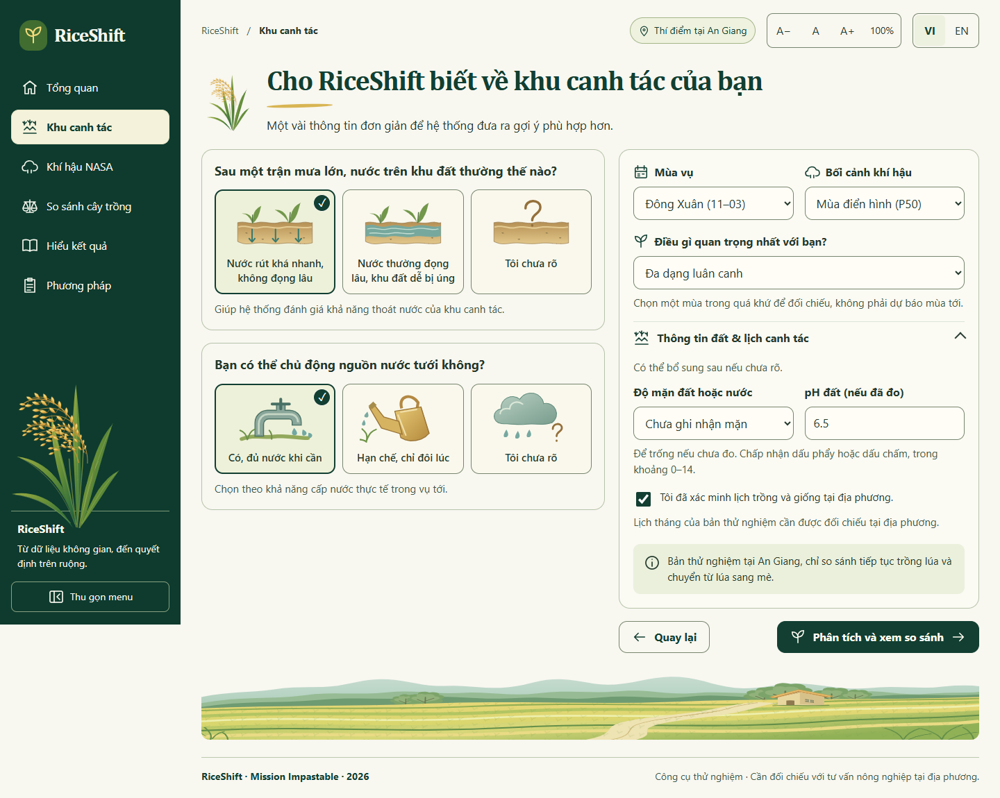
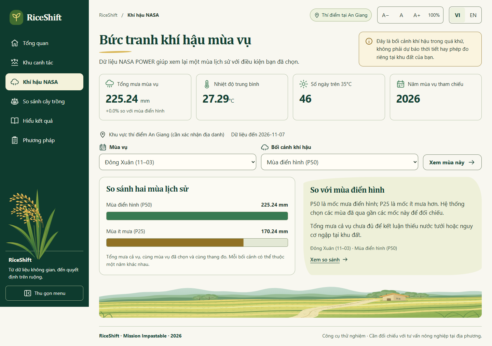
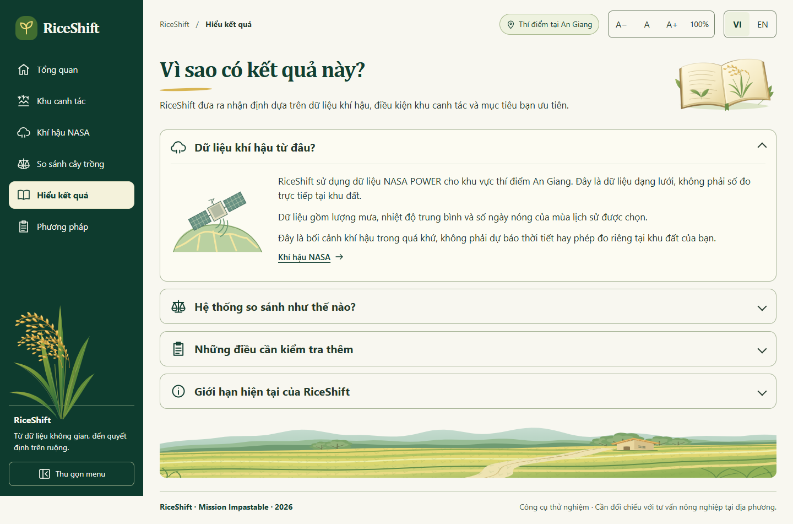
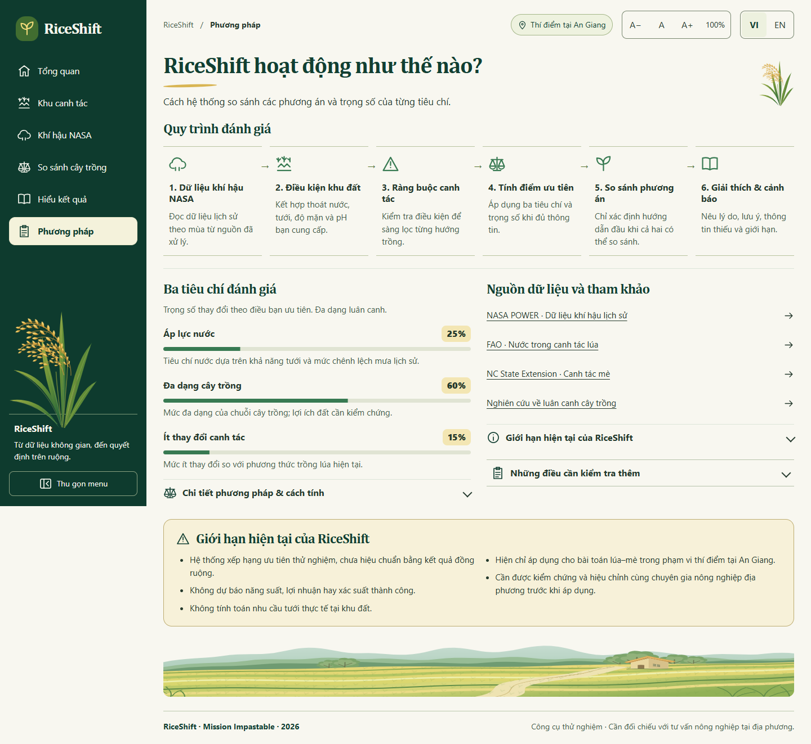

# 🌾 RiceShift

**From space data to decisions in the field.**

**NASA Space Apps Challenge 2026 · Team Mission Impastable**

RiceShift is an experimental web application that helps users compare **continuing to grow rice** with **rotating from rice to sesame** for the next growing season in the An Giang pilot area, Vietnam. It combines NASA POWER historical climate data, reported field conditions, and user priorities to present a transparent comparison with explanations.

[Try the prototype](#try-the-prototype) · [Run locally](#run-locally) · [Git workflow](docs/GIT_WORKFLOW.md) · [Deploy on Render](docs/DEPLOY.md)

## The problem

Choosing a crop for the next season involves more than comparing rainfall totals. Farmers also need to consider drainage, access to irrigation, soil conditions, and how much they are prepared to change their current practices. Historical climate information becomes more useful when these field conditions and priorities are considered together.

RiceShift explores how to make that comparison understandable and explainable for an initial discussion with farmers and local agricultural advisers.

## The proposed solution

Users describe their field, select a historical climate scenario, and choose a priority. RiceShift screens two crop options, shows experimental preference scores where information is sufficient, and explains the reasons, warnings, and missing inputs behind the comparison.

The prototype's contribution is the integration of seasonal NASA data with farmer-reported conditions and explicit decision criteria. Its field-notebook interface, bilingual explanations, and adjustable text size make that information easier to explore. The project has not demonstrated improved agricultural outcomes through field trials.

## NASA data usage

The existing climate pipeline processes NASA POWER daily rainfall and temperature data into seasonal summaries. For each supported growing season, it selects an actual historical season closest to the **P50** or **P25** percentile of seasonal rainfall:

| Scenario identifier | Meaning |
| --- | --- |
| `normal` | Historical season near the P50 seasonal rainfall percentile. |
| `low_rainfall` | Historical season near the P25 seasonal rainfall percentile. |

The interface displays seasonal rainfall, mean temperature, the number of days with maximum temperature above **35°C**, and the historical reference year. It also compares rainfall across the two scenarios.

The Flask application reads `RiceShift/data/processed/climate_payload_latest.json`. Observation dates and data coverage are recorded in its metadata. With the bundled data present, the web demo needs no live NASA API call, API key, or database.

NASA POWER provides gridded historical context. These scenarios are **not weather forecasts**, measurements from an individual field, or estimates of actual irrigation requirements.

## Try the prototype

**Live demo:** [Open the RiceShift web app](https://riceshift.onrender.com/)

Open the Render link to explore the six views and switch between Vietnamese and English. The GitHub repository hosts the source code; the Render link opens the web application.

To explore the implemented workflow:

1. Open **Farm conditions** and enter drainage, irrigation access, season, scenario, soil information, and your priority.

2. Review **NASA climate** for the selected historical context.

3. Open **Crop comparison**, inspect the explanations and missing information, and download the JSON report.

4. Use **Understand results** and **Methodology** to review how the comparison works.

The GitHub repository URL is the source-code location; it is not a hosted Flask demo.

## Implemented features

| View | Purpose |
| --- | --- |
| Overview | Introduces the crop options and the selected seasonal climate context. |
| Farm conditions | Collects drainage, irrigation, season, scenario, salinity, pH, and user priorities. |
| NASA climate | Presents historical seasonal indicators and compares the two rainfall scenarios. |
| Crop comparison | Shows screening outcomes, reference scores, reasons, warnings, and a JSON report. |
| Understand results | Explains data sources, comparison logic, missing information, and limitations. |
| Methodology | Presents the assessment process, goal-dependent weights, and references. |

- **VI / EN** language switching for the interface and existing result explanations.

- Text sizes of **90%, 100%, 125%, 150%, and 200%**, with browser preferences retained.

- A collapsible desktop sidebar, mobile navigation drawer, and keyboard support.

- Core form submission and navigation that remain available without JavaScript.

- Results supplied by Flask and the Decision Engine rather than fixed demonstration scores.

## Screenshots

These images capture the local Flask application with specific input selections. The interface shown is Vietnamese; the application also includes English. Scores and indicators can change with the selected season, dataset, and field conditions.

| Farm conditions | NASA climate |
| --- | --- |
|  |  |

| Crop comparison | Understand results |
| --- | --- |
|  |  |

Methodology and mobile interface

## Run locally

Use **Python 3.12** and Git. These instructions assume your checkout includes the documented Flask interface. If you are already working in the existing local project, skip the clone command and open its `RiceShift` directory.

### Windows / PowerShell

~~~powershell
git clone https://github.com/vuhoaii/agrishift-360.git
Set-Location agrishift-360\RiceShift
py -3.12 -m venv .venv
.\.venv\Scripts\python.exe -m pip install -r requirements-web.txt
.\.venv\Scripts\python.exe -B web.py
~~~

Open [RiceShift locally](http://127.0.0.1:5000/). Calling the virtual environment's Python directly avoids changing PowerShell execution policy.

### macOS / Linux

~~~bash
git clone https://github.com/vuhoaii/agrishift-360.git
cd agrishift-360/RiceShift
python3.12 -m venv .venv
.venv/bin/python -m pip install -r requirements-web.txt
.venv/bin/python -B web.py
~~~

Open [RiceShift locally](http://127.0.0.1:5000/). The `web.py` entry point serves the Flask interface. The separate `app.py` file contains a Streamlit demo; these instructions use Flask. Gunicorn is used for deployment on Linux/Render.

### Local checks

From `RiceShift`, after installing `requirements-web.txt`:

~~~powershell
.\.venv\Scripts\python.exe -B -m unittest test_frontend
.\.venv\Scripts\python.exe -B test_scoring_engine.py
~~~

On macOS/Linux, replace `.\.venv\Scripts\python.exe` with `.venv/bin/python`.

The existing `test_frontend.py` checks the six views in both languages, input state, translations, validation errors, unavailable scores, climate changes, POST requests, and JSON reports. Climate pipeline tests require the additional dependencies in `RiceShift/requirements.txt`. These commands are checks to run, not evidence of scientific validation.

## Project structure

~~~text
agrishift-360/
├── README.md
├── .python-version             # Python 3.12 for Render
├── render.yaml                 # Flask/Gunicorn deployment configuration
├── docs/
│   ├── GIT_WORKFLOW.md          # Copy, review, commit, and push instructions
│   ├── DEPLOY.md                # Render setup and deployment checks
│   └── screenshots/             # Application screenshots used here
└── RiceShift/
    ├── web.py                   # Flask routes and template context
    ├── frontend_i18n.py         # VI/EN interface text
    ├── presentation_messages.py # Presentation-layer message translations
    ├── requirements-web.txt     # Web application dependencies
    ├── services/                # Decision Engine and climate pipeline
    ├── data/processed/          # Processed JSON/CSV payloads
    ├── templates/               # Shared layout, partials, and six Jinja views
    ├── static/                  # CSS, JavaScript, and SVG illustrations
    ├── test_frontend.py
    └── test_scoring_engine.py
~~~

The earlier technical handoff document is preserved at [.README](.README) as legacy notes in Vietnamese.

## Scientific limitations and local validation

- **Historical context:** NASA POWER data is gridded and does not establish conditions at a particular field. Seasonal rainfall totals alone cannot determine irrigation availability, field flooding, or drought.

- **Experimental scores:** The **0–100** scale expresses a provisional preference ranking. It is not validated agronomic suitability, a probability of success, or a prediction of yield or profit.

- **Missing information:** Options can remain unranked when required inputs are unknown, or be excluded from screening when constraints are not met.

- **Heuristic weights:** The team proposed the weights below; they are not scientifically calibrated coefficients.

- **Pilot scope:** The prototype compares rice-to-rice and rice-to-sesame options in An Giang. The location name, seasonal calendar, soil conditions, water supply, and varieties require local confirmation.

- **Field validation:** Local agricultural expertise and field validation are needed before recommendations are applied. Potential benefits such as soil improvement are not established outcomes of this prototype.

| User priority | Water | Crop diversity | Continuity of current practice |
| --- | ---: | ---: | ---: |
| Reduce water pressure | 70% | 10% | 20% |
| Diversify crop rotation | 25% | 60% | 15% |
| Minimize changes to current practice | 25% | 10% | 65% |

## AI tools and asset attribution

- **OpenAI Codex** assisted with frontend implementation, interface translation, documentation, and custom SVG illustration code. **ChatGPT** was also used for planning, reviewing documentation, and exploring UI design ideas. These tools provided development assistance; crop comparisons are produced by the project's Python Decision Engine.

- The rice, sesame, landscape, notebook, and supporting illustrations in `RiceShift/static/illustrations/` were created and edited as SVG code during development. User-supplied visual references informed the interface style. These illustrations are decorative, not NASA imagery or scientific evidence.

- The images in `docs/screenshots/` are captures of the local RiceShift application. They are not generated mockups.

Mission Impastable remains responsible for the submission and for reviewing the code, scientific assumptions, and asset attribution.

## Data and scientific references

- [NASA POWER](https://power.larc.nasa.gov/) — climate data source.

- [FAO: Rice and water](https://www.fao.org/4/S2022E/s2022e08.htm) — reference on water and rice cultivation.

- [NC State: Sesame Production Fact Sheet](https://content.ces.ncsu.edu/sesame-production-fact-sheet) — sesame cultivation reference.

- [Agronomy, DOI 10.3390/agronomy14061185](https://doi.org/10.3390/agronomy14061185) — crop rotation reference cited by the Decision Engine.

**Mission Impastable · RiceShift · 2026**
