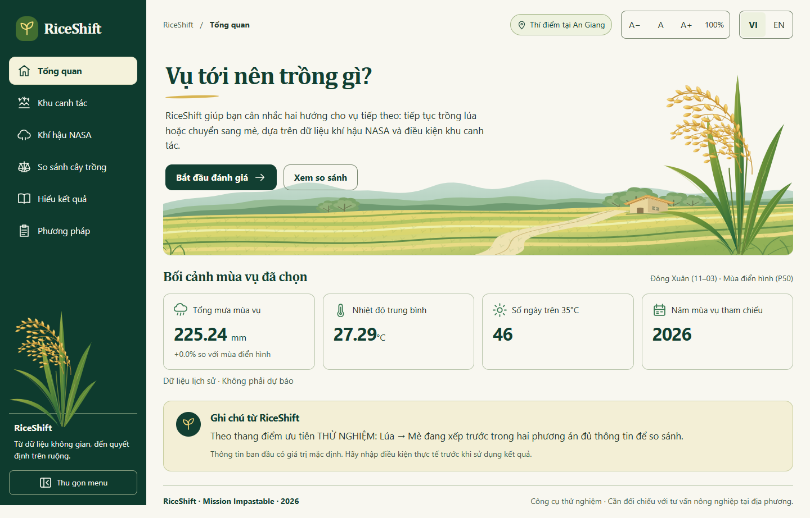
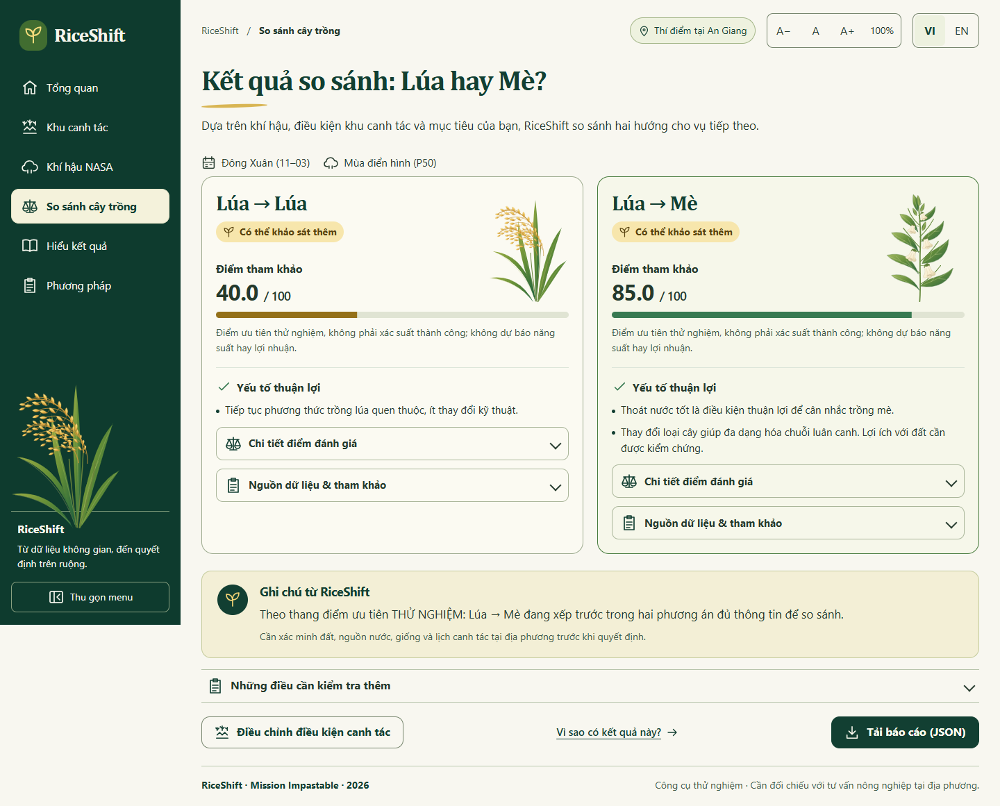
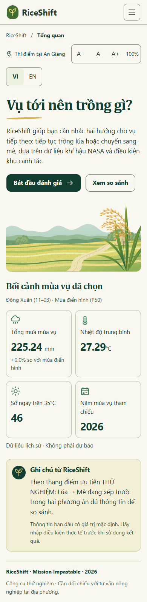

# 🌾 RiceShift

**Từ dữ liệu không gian, đến quyết định trên ruộng.**

RiceShift là ứng dụng web hỗ trợ cân nhắc **tiếp tục trồng lúa** hoặc **luân canh từ lúa sang mè** cho vụ tiếp theo tại khu vực thí điểm An Giang. Ứng dụng kết hợp khí hậu lịch sử từ NASA POWER, điều kiện khu canh tác và mục tiêu người dùng để đưa ra điểm tham khảo kèm giải thích.

Giao diện lấy cảm hứng từ một cuốn sổ tay đồng ruộng: xanh rừng, giấy kem, nét minh họa lúa và cánh đồng, nội dung bằng tiếng Việt và tiếng Anh.

[Hướng dẫn chạy](#chạy-trên-máy) · [Đưa code lên GitHub](docs/GIT_WORKFLOW.md) · [Deploy lên Render](docs/DEPLOY.md)

## Demo công khai

**Trạng thái: chưa triển khai bản giao diện này.** Làm theo [hướng dẫn Render](docs/DEPLOY.md), sau đó thay dòng trạng thái này bằng liên kết dịch vụ thực tế do Render cấp. Kho mã GitHub và website chạy trực tuyến là hai địa chỉ riêng.

<!-- Sau khi deploy thành công, thay phần trạng thái trên bằng:
**Trải nghiệm trực tiếp:** [Mở RiceShift](URL_THAT_TU_RENDER)
Chỉ dùng URL đã mở và kiểm tra thành công.
-->

## Có gì trong RiceShift?

| Màn hình | Nội dung |
| --- | --- |
| Tổng quan | Giới thiệu hai hướng canh tác và bối cảnh khí hậu của mùa vụ đang chọn. |
| Khu canh tác | Nhập thoát nước, khả năng tưới, mùa vụ, kịch bản, độ mặn, pH và mục tiêu ưu tiên. |
| Khí hậu NASA | Xem tổng mưa, nhiệt độ, ngày nóng và mùa lịch sử tham chiếu; so sánh hai kịch bản mưa. |
| So sánh cây trồng | Điểm tham khảo, điều kiện sàng lọc, lý do, cảnh báo và báo cáo JSON. |
| Hiểu kết quả | Giải thích dữ liệu, phương pháp, những thông tin cần xác minh và giới hạn. |
| Phương pháp | Quy trình đánh giá, trọng số thực tế theo mục tiêu và tài liệu tham khảo. |

- Chuyển **VI / EN** cho cả nội dung giao diện và các giải thích hiện có.
- Điều chỉnh cỡ chữ **90%, 100%, 125%, 150%, 200%**; ghi nhớ lựa chọn trên trình duyệt.
- Menu thu gọn trên máy tính, menu dạng ngăn kéo trên điện thoại; hỗ trợ bàn phím.
- Biểu mẫu và điều hướng chính vẫn dùng được khi tắt JavaScript.
- Dữ liệu và kết quả đi từ Flask/Decision Engine; giao diện không tự đặt điểm mẫu.

## Ảnh giao diện

Các ảnh dưới đây được chụp từ website chạy cục bộ, gồm những trạng thái đầu vào cụ thể. Điểm và chỉ số có thể thay đổi theo mùa vụ, dữ liệu và lựa chọn canh tác.

| Khu canh tác | Khí hậu NASA |
| --- | --- |
|  |  |

| So sánh cây trồng | Hiểu kết quả |
| --- | --- |
|  |  |

Phương pháp đánh giá và giao diện điện thoại

## Công nghệ

- **Flask + Jinja2** phục vụ trang và biểu mẫu.
- **HTML, CSS, JavaScript thuần** và minh họa SVG trong thư mục static.
- **Python Decision Engine** đánh giá và giải thích hai phương án.
- **JSON/CSV NASA POWER** đã xử lý, lưu trong dự án.
- **Gunicorn** phục vụ ứng dụng khi triển khai trên Linux/Render.

Bản web đọc `RiceShift/data/processed/climate_payload_latest.json`. Với dữ liệu đã có trong repo, demo không cần gọi NASA API, không cần API key và không cần cơ sở dữ liệu. Ngày cập nhật và khoảng thời gian quan trắc nằm trong metadata của file JSON.

## Chạy trên máy

Khuyến nghị Python **3.12** và Git. Bắt đầu từ một bản clone đã có các thay đổi giao diện này.

### Windows / PowerShell

~~~powershell
git clone https://github.com/vuhoaii/agrishift-360.git
Set-Location agrishift-360\RiceShift
py -3.12 -m venv .venv
.\.venv\Scripts\python.exe -m pip install -r requirements-web.txt
.\.venv\Scripts\python.exe -B web.py
~~~

Mở **http://127.0.0.1:5000/**. Dùng trực tiếp Python trong venv nên không cần thay đổi execution policy của PowerShell.

### macOS / Linux

~~~bash
git clone https://github.com/vuhoaii/agrishift-360.git
cd agrishift-360/RiceShift
python3.12 -m venv .venv
.venv/bin/python -m pip install -r requirements-web.txt
.venv/bin/python -B web.py
~~~

`web.py` là ứng dụng Flask được dùng cho giao diện này. `app.py` là bản Streamlit riêng; quy trình ở đây dùng Flask.

### Kiểm tra cục bộ

Chạy từ thư mục `RiceShift` sau khi cài `requirements-web.txt`:

~~~powershell
.\.venv\Scripts\python.exe -B -m unittest test_frontend
.\.venv\Scripts\python.exe -B test_scoring_engine.py
~~~

Trên macOS/Linux, thay `.\.venv\Scripts\python.exe` bằng `.venv/bin/python`.

`test_frontend.py` kiểm tra sáu màn hình ở cả hai ngôn ngữ, giữ nguyên trạng thái nhập, giải thích được dịch, lỗi biểu mẫu, dữ liệu thiếu, thay đổi khí hậu, POST và JSON. Các bài kiểm tra pipeline khí hậu dùng thêm bộ phụ thuộc trong `RiceShift/requirements.txt`.

## Cấu trúc chính

~~~text
agrishift-360/
├── README.md
├── .python-version             # Python 3.12 trên Render
├── render.yaml                 # Dịch vụ Flask/Gunicorn
├── docs/
│   ├── GIT_WORKFLOW.md          # Commit và push từ bản thư mục hiện tại
│   ├── DEPLOY.md                # Cấu hình và kiểm tra Render
│   └── screenshots/             # Ảnh thật dùng trong README
└── RiceShift/
    ├── web.py                   # Flask routes và dữ liệu cho template
    ├── frontend_i18n.py         # Nội dung giao diện VI/EN
    ├── presentation_messages.py # Dịch giải thích ở lớp hiển thị
    ├── requirements-web.txt     # Phụ thuộc cho website
    ├── services/                # Decision Engine và pipeline khí hậu
    ├── data/processed/          # Payload JSON/CSV đã xử lý
    ├── templates/               # Shell, partials và sáu màn hình Jinja
    ├── static/                  # CSS, JS và minh họa SVG
    ├── test_frontend.py
    └── test_scoring_engine.py
~~~

Tài liệu bàn giao kỹ thuật trước đây vẫn được giữ tại [.README](.README).

## Cách hiểu kết quả

NASA POWER cung cấp bối cảnh khí hậu lịch sử dạng lưới, không phải phép đo riêng tại từng thửa ruộng. Hai kịch bản chọn mùa lịch sử gần phân vị tổng mưa **P50** và **P25**; chúng không phải dự báo thời tiết.

Điểm **0–100** là thang ưu tiên **thử nghiệm**, không phải xác suất thành công, dự báo năng suất hoặc lợi nhuận. Phương án có thể chưa được xếp hạng khi thiếu thông tin hoặc bị loại khỏi sàng lọc khi không đáp ứng ràng buộc.

Trọng số do nhóm đề xuất và thay đổi theo mục tiêu:

| Mục tiêu | Nước | Đa dạng luân canh | Liên tục cách canh tác |
| --- | ---: | ---: | ---: |
| Giảm áp lực nước | 70% | 10% | 20% |
| Đa dạng luân canh | 25% | 60% | 15% |
| Ít thay đổi cách canh tác | 25% | 10% | 65% |

Địa danh, lịch mùa vụ, đất, nguồn nước và giống cần được xác minh cùng người có chuyên môn tại địa phương trước khi áp dụng ngoài đồng ruộng.

## Nguồn tham khảo

- [NASA POWER](https://power.larc.nasa.gov/) — nguồn dữ liệu khí hậu.
- [FAO: Rice and water](https://www.fao.org/4/S2022E/s2022e08.htm) — tham khảo về nước và canh tác lúa.
- [NC State: Sesame Production Fact Sheet](https://content.ces.ncsu.edu/sesame-production-fact-sheet) — tham khảo canh tác mè.
- [Agronomy, DOI 10.3390/agronomy14061185](https://doi.org/10.3390/agronomy14061185) — tài liệu về luân canh được trích trong Decision Engine.

**Nhóm phát triển: Mission Impastable · RiceShift · 2026.**
